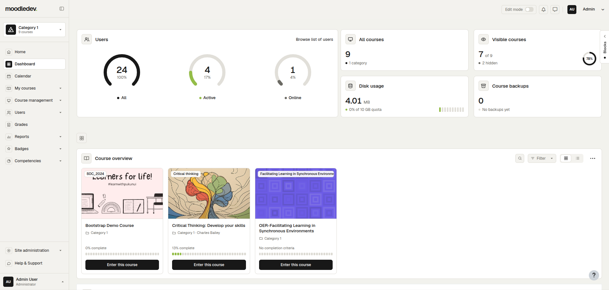

# Retani Studio theme for Moodle

Retani Studio (`theme_retani_studio`) is a modern theme for Moodle based on Boost. It keeps the core markup that
Moodle and other plugins rely on, and adds:

- a retractable left navigation bar and a collapsible block sidebar, both usable on mobile;
- a redesigned split-screen login page with an image carousel;
- a refreshed dashboard course overview;
- restyled quiz pages;
- an optional light and dark colour mode (experimental).



## Requirements

- Moodle 5.3 (build 2026100200 or later)
- PHP 8.3 or later

## Installation

1. Copy this folder to `public/theme/retani_studio` in your Moodle installation, or install the ZIP package from
   *Site administration > Plugins > Install plugins*.
2. Log in as an administrator and complete the upgrade at *Site administration > Notifications*.
3. Select the theme at *Site administration > Appearance > Themes*.

## Settings

The settings are at *Site administration > Appearance > Themes > Retani Studio*, in seven tabs.

### General settings

| Setting | Description |
| --- | --- |
| Unneeded blocks | Blocks that will not be listed in the *Add a block* menu. |
| Theme preset | The preset that sets the overall look: `default.scss`, `plain.scss` or `preset-retani.scss`, or one you upload. |
| Additional theme preset files | Upload your own preset files to add them to the list above. |
| Background image | An image shown as the site background. It overrides the background image set in the preset. |
| Login page background image | An image shown behind the left panel of the login page. |
| Logo | The logo at the top of the login page panel. The site name is shown when no logo is uploaded. |
| Brand colour | The accent colour. |

### Login page

The carousel on the left of the login page has up to four slides.

| Setting | Description |
| --- | --- |
| Number of slides | How many slides to show, from 0 to 4. 0 hides the carousel. |
| Slide title, text and image description | Leave a field empty to use its default from the language pack. |
| Slide image | Leave empty to use the image included with the theme. Landscape images of about 1200 × 800 pixels work best. |

The carousel is not shown when the site has instructions set in *Site administration > Plugins > Authentication >
Manage authentication*. The instructions are shown in its place.

### Front page

The site home is replaced by a landing page, set up in three tabs: *Front page*, *Front page: people* and
*Front page: news & footer*. Text settings start with the text of the design; empty a setting to hide what it fills.

| Setting | Description |
| --- | --- |
| Use the Retani front page | Turn the landing page off to use the standard site home. The landing page has no edit mode; turn it off to edit the standard site home's blocks and content. |
| Sections | The sections to show. *Standard site home content* adds the content set in *Site home settings*. |
| Courses | Course IDs to show, in order. Empty shows the newest courses. The first one is featured in the header's courses menu. |
| Images | Hero, about and instructor call images fall back to the images bundled with the theme. |
| Instructors, testimonials | Up to six each, with photos. People without a photo are shown with their initials. |
| News | The latest posts of the site announcements forum. A post with an attached image shows that image. |
| Footer links | One link per line as `Text\|/path` or `Text\|https://…`. |

### Advanced settings

| Setting | Description |
| --- | --- |
| Raw initial SCSS | SCSS added before everything else, usually to set variables. |
| Raw SCSS | SCSS or CSS added at the end of the style sheet. |

### Experimental settings

| Setting | Description |
| --- | --- |
| Dark mode for Site administration | Shows the Site administration pages dark to site administrators only. On by default. Only used while colour modes are off; when they are on, admin pages follow the colour mode menu, so there is one control. |
| Enable colour modes | Lets people switch the site between light and dark. Off by default. |
| Default colour mode | The mode for people who have not chosen one. Defaults to *Light*. |

## Development

The theme uses AMD modules (`amd/src`) and React components written in TypeScript (`js/esm/src`). Built files are
committed. From the Moodle root, rebuild them with:

```bash
npx grunt amd
npx grunt esm
```

Purge caches after changing templates, language strings or SCSS.

See `readme_moodle.txt` for how to update the bundled Bootstrap, and `thirdpartylibs.xml` for third-party libraries,
fonts and images.

## Licence

Copyright © 2026 Okeowo Aderemi. Based on the Boost theme, copyright © 2016 Frédéric Massart.

This program is free software, licensed under the GNU General Public License version 3 or later. See [LICENSE](LICENSE).
